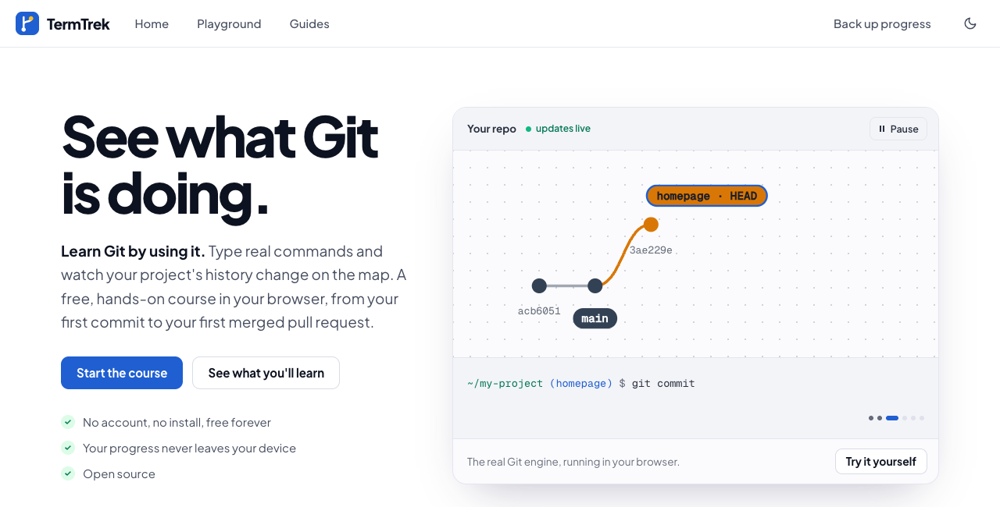
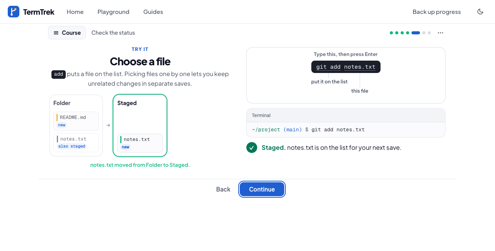
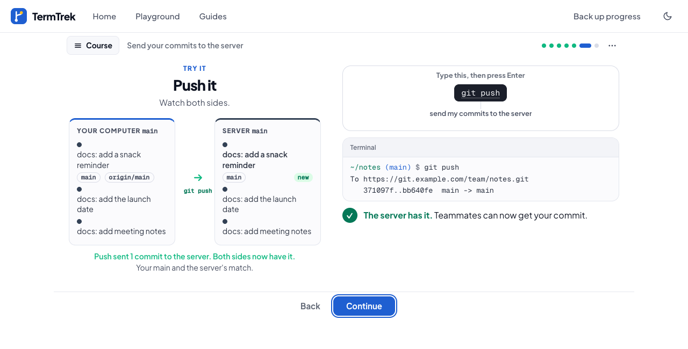
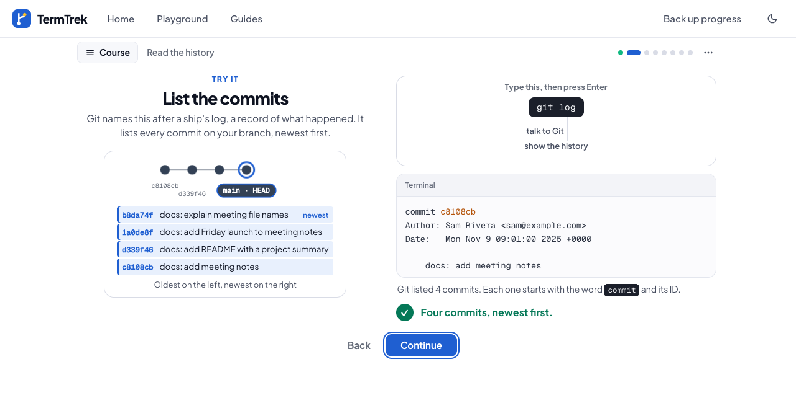
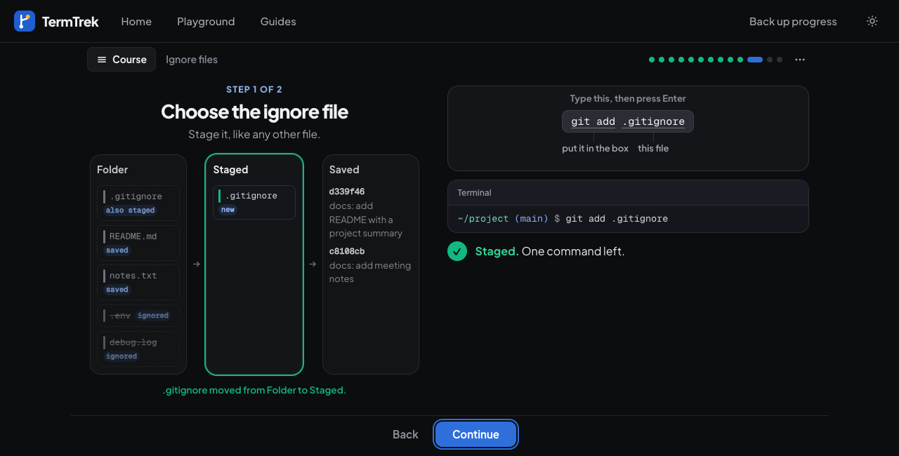

<div align="center">

# TermTrek

**See what Git is doing.** A free, hands-on Git course that runs in your browser.

[](https://www.gnu.org/licenses/gpl-3.0)
[](https://github.com/chrisglaske/termtrek/actions/workflows/live.yml)

[**Start learning at termtrek.work**](https://termtrek.work)



</div>

---

## What it is

TermTrek teaches Git by letting you use it. You type real Git commands into a simulated terminal and watch your project change on screen as you go: files moving between the Folder, Staged and Saved boxes, commits joining the graph, work travelling to a team server and back. It is for people who have never used Git, people who want to get properly good at it, and non-developers who write code with AI tools and want a safety net.

- **No account, no install.** Open the site and start.
- **Nothing saved about you.** There is no backend and no sign-in. Your progress and theme stay in your own browser (localStorage) and are never sent anywhere.
- **Free and open source**, under GPL-3.0.

## A look inside

| | |
| --- | --- |
|  |  |
| **Every command shows its effect.** A caption says what moved. | **Teamwork is visible.** Watch a push or fetch cross to the server. |
|  |  |
| **Mistakes are explained.** An amend replaces a commit, and the graph says so. | **Light and dark.** Ignored files are dimmed, not hidden. |

## Features

- **Calm, one-idea pages.** Each lesson is a short run of pages that fit one screen. You type the command yourself; the letters glow green as you get them right and the first wrong one turns red.
- **Interactive terminal.** Feedback mirrors real Git, with plain explanations when something goes wrong.
- **Pictures that follow your commands.** The folder tree, the boxes, the commit graph, the server and pull request views all update as you type.
- **Simulated team server.** Clone, push, pull, open a pull request and merge it, with a teammate who pushes changes while you work.
- **Conventional Commits.** The commit-message lesson teaches the `type(scope): summary` format, and later lessons use it.
- **Playground.** A free sandbox with a sample project and server, with no lesson steps to follow.
- **Guides.** Short reference pages for setting up Git on your own machine, with a macOS/Windows switch.

## The course

The launch course has four sections and 34 lessons:

| Section | Lessons | You learn to |
| --- | --- | --- |
| Foundations | 10 | Use the terminal, make a repo, stage and commit, write good messages, read history, ignore files |
| Fixing mistakes | 7 | Unstage, discard, amend, undo with revert, rewind with reset, and get lost work back |
| Branching | 8 | Branch, switch, merge, resolve conflicts, and stash work in progress |
| Working with a team | 9 | Clone, push, pull and fetch, open and merge a pull request, and update a branch |

Two more sections, Pro skills and Automation, are planned.

## The live site is this code

The build is reproducible, so building this repository gives exactly the files termtrek.work serves. A [check](https://github.com/chrisglaske/termtrek/actions/workflows/live.yml) compares them byte for byte on every change to the site and once a day. The only thing it ignores is the anonymous page-count snippet Cloudflare adds to the home page. You can run it yourself:

```sh
npm ci && npm run build && node scripts/verify-live.mjs
```

## Run it locally

```sh
npm install
npm run dev      # start the dev server
npm run verify   # typecheck, tests, production build and dist checks
```

## How it is built

TermTrek is a React and TypeScript app built with Vite and tested with Vitest. There is no server: everything runs in the browser.

- `src/engine` is a simulated Git engine: a small shell, an in-memory file system, repositories, merging, and a fake remote server.
- `src/lessons` holds the course. `course.ts` lists the sections and lessons, and `schema.ts` defines the `Lesson` type. Each lesson is one file in a section folder (`foundations`, `fixing`, `branching`, `team`).
- A lesson has a starting `setup` (files, config, remote) and steps. Each step has `learn` text, a `task`, `hints`, a `solution`, and a `check` that inspects the world after each command. Most lessons also define `pages`, the calm read and do pages the learner sees, each with a `visual` (stage, tree, graph, server, pull request or identity) drawn from the live world. See `src/lessons/foundations/what-is-git.ts` for a worked example.
- `src/ui` is the interface (terminal, repo map, remote panel, lesson pages and their pictures, Playground, landing page), and `src/guides` holds the guide pages.

## Contributing

Please open an issue before starting work, so we can agree on the change first. Before you open a pull request, `npm run verify` must pass. Commit messages follow [Conventional Commits](https://www.conventionalcommits.org/), for example `feat(ui): add search`. If you change how a lesson looks, retake the matching image in `docs/screenshots/`.

## Privacy

TermTrek sets no tracking cookies. It uses Cloudflare Web Analytics for anonymous page counts only. Your lesson progress and theme choice are stored only in your own browser (localStorage); nothing is sent anywhere.

## License

GPL-3.0. See [LICENSE](LICENSE).
